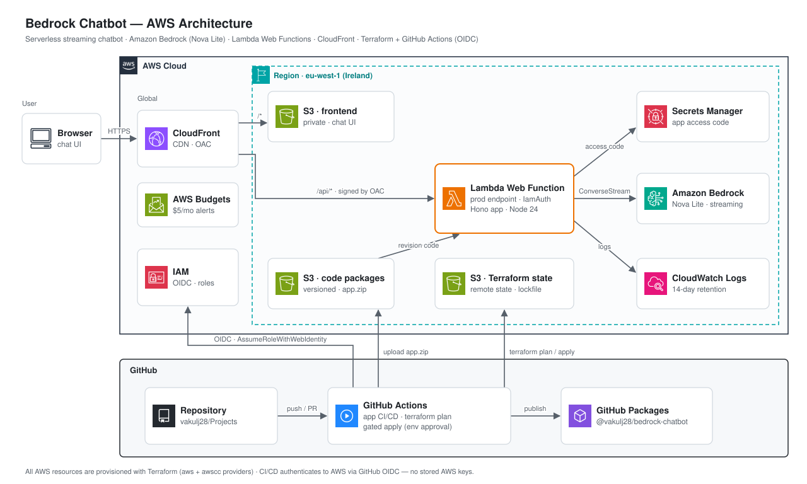

# Bedrock Chatbot

A serverless AI chatbot on AWS: a streaming chat UI backed by **Amazon Bedrock (Nova Lite)**, running on **AWS Lambda Web Functions**, fronted by **CloudFront**, and provisioned end-to-end with **Terraform** and a **keyless GitHub Actions CI/CD** pipeline.

The whole thing is serverless and scales to zero — there is no model server, API server, or container to run. A request only costs money while it's actually being processed.

> **Why it exists:** a portfolio project to demonstrate modern serverless AI, infrastructure-as-code, and secure CI/CD on AWS — including adopting a brand-new AWS primitive (Lambda Web Functions, launched Oct 2026) within weeks of its release.

---

## Architecture



### Request flow

1. The browser loads the chat page from **CloudFront** (served from a private S3 bucket).
2. A chat message is `POST`ed to `/api/chat`. CloudFront **signs the request** (Origin Access Control) and forwards it to the Lambda Web Function.
3. The function validates CloudFront's signature (**IamAuth**), then the app checks an **access code** (from Secrets Manager) before doing any work.
4. The app calls **Bedrock `ConverseStream`** with Amazon Nova Lite and **streams** the tokens straight back to the browser.

No credentials are ever stored: the app authenticates to Bedrock with its IAM **execution role**, and CI/CD authenticates to AWS with **GitHub OIDC**.

---

## Tech stack

| Area | Services & tools |
|------|------------------|
| **AI inference** | Amazon Bedrock — Amazon Nova Lite (`eu.amazon.nova-lite-v1:0` inference profile), `ConverseStream` streaming API |
| **Compute** | AWS Lambda **Web Functions** (`nodejs24.x`), scale-to-zero HTTP server |
| **Application** | TypeScript, [Hono](https://hono.dev/), esbuild (bundling), Vitest (tests), Node 24 |
| **Edge / CDN** | Amazon CloudFront + Origin Access Control (S3 and Lambda origins) |
| **Storage** | Amazon S3 — static frontend, code packages, remote Terraform state |
| **Secrets** | AWS Secrets Manager (app access code, kept out of Terraform state) |
| **Identity** | AWS IAM + GitHub OIDC (keyless), least-privilege scoped roles |
| **Observability / cost** | CloudWatch Logs (short retention), AWS Budgets alerts |
| **IaC** | Terraform (`hashicorp/aws` + `hashicorp/awscc`), S3 backend with native locking |
| **CI/CD** | GitHub Actions, GitHub Packages (built artifact), gated deploys via a protected Environment |

---

## What we built, step by step

| Phase | What | Key services / tools |
|-------|------|----------------------|
| **0** | Account prep: IAM Identity Center (SSO), Bedrock access, first `Converse` call | IAM Identity Center, Bedrock |
| **1** | Terraform bootstrap: remote-state bucket, budget alert, GitHub OIDC provider, read-only CI plan role | Terraform, S3, Budgets, IAM/OIDC |
| **2** | The app: Hono server streaming Bedrock, constant-time access-code check, unit tests, local run | TypeScript, Hono, Bedrock SDK, Vitest |
| **3** | App infrastructure: versioned code bucket, least-privilege execution role, Secrets Manager secret (write-only, out of state), log groups | Terraform, S3, IAM, Secrets Manager, CloudWatch |
| **4** | Create the Lambda Web Function + `prod` endpoint (IamAuth), deploy the first revision, verify with a signed request | Lambda Web Functions, SigV4 |
| **5a** | Put CloudFront in front of the API with OAC so browsers don't sign requests | CloudFront, OAC (`awscc` provider) |
| **5b** | Static chat UI on a private S3 bucket behind the same distribution (`/*` → S3, `/api/*` → Web Function) | CloudFront, S3, OAC |
| **CI/CD** | Keyless GitHub Actions throughout: app test/build → GitHub Packages + S3 upload; Terraform plan on PRs, **gated** apply on `main` | GitHub Actions, OIDC |

---

## Security highlights

- **No long-lived credentials anywhere.** Local work uses AWS SSO; CI/CD uses GitHub **OIDC** to assume scoped roles.
- **Least-privilege IAM.** Separate CI roles for *plan* (read-only), *apply* (write, enumerated actions scoped to the project's own resources), and *app deploy* (write to the code bucket only).
- **Human-gated infra changes.** `terraform apply` runs only after approval in a protected GitHub Environment; app deploys are continuous.
- **Two auth layers on the API.** CloudFront OAC request signing (IAM) + an application access code from Secrets Manager.
- **Secrets stay out of state.** The access code is generated randomly and written with Terraform's write-only argument, so it never lands in state or the repo.
- **Scoped Bedrock access.** The execution role may invoke only the Nova Lite model, nothing else.

---

## Cost

Designed to run on a budget AWS account:

- **Bedrock** — pay per token; with Nova Lite and a `maxTokens` cap, a message is a fraction of a cent.
- **Lambda Web Function** — billed on active CPU + memory; scales to zero. Guardrails: `maxEnvironments = 2`, `rateLimit = 100`.
- **Secrets Manager** — ~$0.40/month (the only fixed cost).
- **CloudFront / S3 / CloudWatch / IAM** — effectively free at this scale.
- A monthly **AWS Budget** emails alerts at 50/80/100%.

> Expect **under ~$1–2/month** while active; `terraform destroy` brings it to near zero.

---

## Repository layout

```
bedrock-chatbot/
├── app/                 # Hono + TypeScript app (streams Bedrock)
│   ├── src/
│   │   ├── index.ts     # entry — binds AWS_LAMBDA_HTTP_ENDPOINT
│   │   ├── app.ts       # routes, validation, streaming
│   │   ├── bedrock.ts   # ConverseStream integration
│   │   ├── auth.ts      # access-code middleware
│   │   └── config.ts    # env + Secrets Manager
│   └── test/
├── frontend/
│   └── index.html       # static chat UI (vanilla, streaming fetch)
├── infra/terraform/     # all infrastructure
└── docs/
```

Workflows live at the repo root under `.github/workflows/`.

---

## Deploying it yourself

**Prerequisites:** an AWS account, AWS CLI v2 (with the `lambda-web` commands), Terraform ≥ 1.11, Node ≥ 24, and the GitHub CLI.

1. **Bootstrap** `infra/terraform` locally once (creates the state bucket, OIDC provider, and CI roles), then set the repo variables for the role ARNs and code bucket.
2. **Push** — pull requests run `terraform plan` and the app CI; merges to `main` build/upload the app and run a **gated** `terraform apply`.
3. **Create the Web Function** once (it points at the uploaded `app.zip`); subsequent app code lands in S3 via CI.
4. **Attach** the CloudFront resource policy to the Web Function, and open the CloudFront URL.

The CloudFront domain and other endpoints are Terraform outputs (`terraform output`).

---

## Notable problems solved

Real engineering friction, each a good story:

- **Custom OIDC subject claim.** The GitHub org embeds numeric owner/repo IDs in the OIDC `sub` (`repo:owner@id/repo@id:...`), so the standard `repo:owner/repo:...` trust policy never matched. Fixed by pinning on the clean `repository`/`environment` claims and wildcarding the `sub`.
- **`always-amz-auth` OAC.** Lambda Web Function origins require a signing behavior the Terraform `aws` provider doesn't allow — solved with the **`awscc`** (Cloud Control) provider.
- **Cloud Control IAM namespace.** `awscc` resources are authorized under `cloudformation:*Resource`, **not** `cloudcontrol:*` — a non-obvious least-privilege gotcha.
- **curl + Lambda IamAuth.** `curl --aws-sigv4` only adds `x-amz-content-sha256` for S3, so direct signed calls 403'd until the header was added manually (CloudFront handles this automatically in the browser path).

---

## Possible next steps

- Per-user authentication (Amazon Cognito) instead of a shared access code.
- Add `create-web-function-revision` to CD so merges roll out new app code automatically.
- CloudWatch alarms and Bedrock Guardrails.
- Conversation history (AgentCore Memory or DynamoDB).
